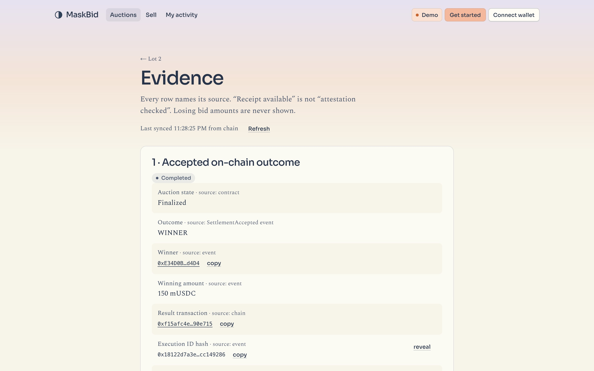

# MaskBid

Sealed-bid auctions for one verified asset token, on NEAR: bidders lock a fixed deposit and submit an encrypted bid in
one transaction, every accepted bid is committed to an ordered on-chain digest, a solver ranks the complete set
privately inside a TEE, and payment, token delivery, refunds and default penalties settle in the same contract.

Everything on chain is one NEAR contract (`maskbid-v2.testnet`) plus a NEP-141 payment token. The contract calls the
solver on OutLayer itself and takes the answer as the result of that call, so there is no bridge, adapter account or
relayer between a request and its result. The project started on Aurora (Solidity + a NEAR adapter); that build is
kept below under "Legacy: the Aurora build" until its last pieces are removed.

Track: **Privacy & Private AI**. Built at NEAR HACKATHON.

## The problem

On a public chain every bid is visible the moment it is sent, so late bidders copy or outbid by one unit and honest
bidders shade their price. Commit-reveal hides the amount but needs a second transaction from every bidder and lets a
loser refuse to reveal; a trusted operator hides it but can read or drop bids. MaskBid keeps one transaction per
bidder, commits the complete bid set in a NEAR contract, and has that contract call a TEE to rank it, so only the
winning amount ever becomes public and the contract accepts a result only for that exact set.

| Landing | Evidence for a settled lot |
| --- | --- |
|  |  |

More in `release/screenshots/`.

## Contracts on NEAR

`contracts/` holds a Cargo workspace (Rust, near-sdk). **Status: deployed on NEAR testnet; full auctions have settled
there with the real OutLayer TEE, and the web app (`apps/web`) reads and writes that deployment. No keeper or indexer
is needed: the contract builds the solver's input itself and every page reads contract views.**

- `maskbid` is one contract: participant registry, asset ledger (one unit per token id, NEP-171 views, `nft_transfer`
  and events), auctions, and the OutLayer calls the adapter used to make. A cross-contract read on NEAR is
  asynchronous, so one state keeps eligibility, asset and escrow checks atomic. The contract calls OutLayer itself and
  takes the solver output as the promise result of that call, so there is no callback sender to pin.
- `mock-usdc` is a NEP-141 test token with a faucet (near-contract-standards).
- Protocol v1 does not change. A NEAR account takes the 20-byte address slot as the last 20 bytes of
  `keccak256(account id)` (`address_of` view); the chain id is the deployment's domain number (398 on NEAR testnet).
  `@maskbid/protocol` and the solver's hashing, envelope and ranking code are used as they are. The solver source is
  pinned to `maskbid-v2.testnet` as its only caller (`PINNED_CALLER` and `manifest.json`), which gives the code hash
  `0x785b0589...79d4`. Earlier deployments keep the builds they were made with (v1 on `maskbid.testnet`:
  `0xdfb1e427...cd12`; Aurora: `0xccca50e5...1ae8`).
- Bid envelopes are kept in contract state and the contract assembles the solver manifest itself, so nobody submits a
  manifest and no log indexer is needed for settlement.
- Each OutLayer run is paid by the caller: attach `executionDeposit` (see `get_config`, 0.1 NEAR on testnet) to
  `prepare_auction_key`, `redispatch_key`, `request_settlement` and `retry_settlement`. The caller is OutLayer's
  payer, so the unused part comes straight back: a run costs about 0.0012 NEAR, a timed-out one 0.001.

| Aurora (Solidity) | NEAR (`maskbid`) |
| --- | --- |
| `prepareAuctionKey` + adapter `request_key` + `onKeyPrepared` | `prepare_auction_key`, result in `get_key` |
| `createAuction` (ERC-1155 escrow transfer) | `create_auction` (the unit moves to escrow inside the contract) |
| `placeBid` (`transferFrom` the deposit) | `ft_transfer_call` of the deposit to `maskbid`, msg `{"action":"bid","auction_id":1,"envelope":"0x.."}` |
| `requestSettlement` + keeper `submit_manifest` + `onSettlementResult` | `request_settlement` |
| `claimWin` (`transferFrom` the remainder) | `ft_transfer_call` of the remainder, msg `{"action":"claim","auction_id":1}` (`claim_win` when nothing is left to pay) |
| `claimRefund`, `expireClaim`, `cancelAuction`, `cancelAfterSolverTimeout`, `claimReturnedAsset` | same names in snake_case; payouts go to the caller |
| `withdrawSellerCredit` | `withdraw_credit` (also holds any payout whose token transfer failed) |

```bash
npm run test:near    # cargo test: 9 tests, the settlement ones run the real solver library on the contract's SOLVE input
npm run build:near   # contracts/dist/maskbid.wasm and mock_usdc.wasm
```

Needs Rust with the `wasm32-unknown-unknown` target.

### NEAR testnet deployment

| What | Account / value |
| --- | --- |
| MaskBid contract | `maskbid-v2.testnet` (protocol address `0xaba28f2af760061ff0253762ba6824a47fa62c01`, chain id 398) |
| Payment token (mUSDC, 6 decimals, `faucet`) | `maskbid-usdc.testnet` |
| Admin, registrar, verifier | `maskbid-keeper.testnet` |
| Solver (OutLayer `outlayer.testnet`) | `0x785b05898729ec13fe1788c6ca85d07ae084757d15b30ffe51ccaf78cf8f79d4` |
| Config hash | `0x5ecef32a311e5ec83d4e3b348b3392946f4ba848466175a4e9c3261d8f644323` |
| Settlement attempts per auction | 8 (a failed TEE run can be retried at once) |
| Participant verification | self-service with simulator assurance (`register_simulated`), or the registrar |

v2 replaced `maskbid.testnet` (v1) on 2026-11-14: v1 allowed three settlement attempts and only registrar
verification. Both values are part of the config hash, so v2 is a fresh deployment; v1 stays on chain with its four
auctions (all settled or recovered).

Full record: `contracts/deployments/near-testnet.json`. `npm run near:testnet` runs one complete auction against it
(about ten minutes) and appends the result, with transaction ids, to `release/near-testnet-run.json`: the seller's key is made and sealed in
the TEE, two bidders seal bids in the client and lock deposits with `ft_transfer_call`, a bid with the wrong deposit
is refunded by the token, the TEE ranks the bids from the manifest the contract built, the winner pays the remainder
and receives the unit, the loser is refunded, and a payout to a seller who cannot hold the token yet becomes a credit
that is withdrawn later. The contract ends with no locked deposits, no credits and no tokens.

OutLayer on testnet was unreliable during these runs: its two-minute yield timed out (`null` output) on two of the
first three key requests, which `redispatch_key` recovered, and on all three settlement attempts of v1's auction 2,
which left that auction to the solver-timeout exit (hence eight attempts in v2). The first full run on v2 needed them:
OutLayer timed out on settlement attempts 1 to 4 and the fifth produced the result, which the contract accepted. `node scripts/near-testnet.mjs recover <id>` drives that exit once the
settlement deadline has passed: anyone cancels, bidders take their deposits back, the seller takes the unit back.

Not run on testnet: the no-sale and winner-default paths (unit-tested only), and a 32-bid auction.

The same flow was also driven through the web app against v1: register an asset, approve it as the verifier, request
the key (the first TEE run timed out, the retry button recovered it), publish the auction, place two sealed bids from
two accounts (each checked against the commitment the contract stored), request settlement, and pay and claim as the
winner. On v2 a wallet session through NEAR Connect (the NEAR CLI wallet) registered itself as a participant.

## Try it

Requirements: Node 22+ and npm. Rust with the `wasm32-unknown-unknown` target only if you want to build or test the
contracts.

```bash
npm install
npm run web          # http://localhost:3000, reading and writing the NEAR testnet deployment
```

The web app needs no configuration: it reads `maskbid-v2.testnet` through public RPC nodes, and you act through your
own NEAR wallet. **Connect account** opens [NEAR Connect](https://github.com/hot-dao/near-selector), which lists the
wallets that support testnet (Meteor, Intear, Nightly, Ledger, NEAR CLI and others); switch your wallet to testnet
first. The wallet signs every transaction; the app never sees a key. Then:

1. **Verify** (`/verify`): on this demo deployment your account registers itself with simulator assurance in one
   transaction. That gives one bid per account, not per person, and every page says "Simulated".
2. **Gas**: about half a NEAR from the [testnet faucet](https://near-faucet.io/). Starting a TEE run (a seller's key,
   a settlement request) attaches 0.1 NEAR, of which all but about 0.0012 comes straight back.
3. **mUSDC**: the button on any lot or in My activity mints 1,000 test mUSDC.
4. **Sell**: register an asset, then ask the operator to approve it (the verifier role is `maskbid-keeper.testnet`),
   or run your own deployment to play that role. **Bid**: open a live lot, type an amount, sign one transfer.

For a local demo that plays every role from one browser, `npm run web:near` (port 3001, profile `.env.web-near`)
offers the accounts named in `NEAR_DEMO_ACCOUNTS` in the connect dialog, signing with their keys from this machine's
near-cli keychain. That route answers on localhost only; never set it on a public deployment.

Your own deployment, with [near-cli-rs](https://github.com/near/near-cli-rs) and three testnet accounts (contract,
token, operator):

```bash
npm run build:near                       # contracts/dist/maskbid.wasm, mock_usdc.wasm
# 1. set PINNED_CALLER in apps/private-solver/src/main.rs and "callers" in manifest.json to your contract account
apps/private-solver/build.sh             # prints SOLVER_CODE_HASH
scripts/fastfs-upload.py apps/private-solver/dist/maskbid-private-solver.wasm <operator>.testnet   # prints the wasm url
# 2. deploy the token with init `new {}` and the contract with init `new { admin, registrar, verifier, token,
#    outlayer: "outlayer.testnet", wasm_url, wasm_hash, chain_id: 398, profile: "demo", allow_simulator: true,
#    execution_deposit: "100000000000000000000000" }`, then `storage_deposit` the contract account on the token
npm run near:testnet                     # one full auction against the deployment in scripts/near-testnet.mjs
```

## What is not here (honest limits)

- **Simulated proof of personhood only.** World ID is not wired in. On this demo deployment an account registers
  itself, so the limit is one bid per account, not per person; the registrar path for a real provider is in the
  contract but has no provider behind it.
- **Asset review is centralised.** One verifier account approves assets; on the shared deployment that is the operator.
- **TEE attestation is not verified** by the contract or the web app. The contract pins the solver's code hash and
  OutLayer refuses other bytes, but nothing here checks a TDX quote.
- **OutLayer testnet is unreliable.** Key and settlement runs time out often; the contract records the failure, lets
  anyone retry, and frees deposits and the asset at the settlement deadline if no result arrives (eight settlement
  attempts per auction, each retried by a click).
- **Not audited.** The contracts have unit tests and testnet runs, not a review. The no-sale and winner-default paths
  ran in unit tests only.
- **Storage is paid from the contract's own NEAR balance**, gated by the participant registry rather than by per-call
  storage deposits.
- **Read model:** pages read contract views and poll public RPC nodes, which rate-limit; there is no indexer.

## Legacy: the Aurora build

Everything below describes the first build of MaskBid (Solidity on Aurora, a NEAR adapter contract, a keeper and a
PostgreSQL indexer). Those sources are still in the tree (`contracts/src`, `apps/near-adapter`, `apps/keeper`,
`apps/indexer`, `apps/solver`, the EVM scripts) and its testnet evidence is in `release/`, but **the web app no longer
talks to it** and `apps/private-solver` is now pinned to `maskbid-v2.testnet`.

### Layout

| Path | What |
| --- | --- |
| `contracts/` | Foundry. `ParticipantRegistry`, `MaskBidAsset` (ERC-1155, one unit per id), `MaskBidAuction`, `MockUSDC`, `Protocol` hashing library. 31 tests: golden auction accounting, winner default, no-sale, solver timeout, retry/stale/duplicate callbacks, XCC dispatch, bid rules, entry pause, key binding, asset roles, Solidity-side protocol vectors. |
| `contracts/maskbid/`, `contracts/mock-usdc/` | **NEAR-native rewrite (Rust, near-sdk), no Aurora.** See "Contracts on NEAR" above. Deployed on NEAR testnet as `maskbid-v2.testnet` and `maskbid-usdc.testnet`. |
| `packages/protocol/` | TypeScript protocol v1: amount grammar (bigint only), keccak domain hashes, 201-byte plaintext, 490-byte AES-GCM + RSA-OAEP envelope, manifest validation, deterministic ranking. Tested against `vectors/protocol-vectors.json`; the same vectors are checked in Solidity (`contracts/test/Protocol.t.sol`). |
| `packages/contracts/` | Generated ABIs + deployment manifest (`npm run sync`), chain helpers. |
| `apps/private-solver/` | Rust `wasm32-wasip2` OutLayer guest: `INIT_KEY` (RSA-OAEP-2048 keygen, seed sealed with the host key `auction_keys` bound to this exact build + the adapter as predecessor), `SOLVE` (manifest steps 1-8, decrypt, rank, canonical result), `UNSEAL_PROBE` (G-02 negatives). Reproduces `protocol-vectors.json` byte for byte (`cargo test`). `build.sh` prints the SHA-256 that is `SOLVER_CODE_HASH`. |
| `apps/near-adapter/` | NEAR contract (near-sdk): accepts `request_key` / `request_solve` only from the pinned XCC router `<hex(auction)>.aurora`, runs the pinned WasmUrl on `outlayer.testnet`, stores SPKI + sealed blob + keyId, checks every result binding, delivers `onKeyPrepared` / `onSettlementResult` through the engine `call` (EVM sender = implicit address of the adapter account = `callbackSender`). |
| `apps/indexer/` | Read model (blueprint 08): replays Aurora logs into PostgreSQL using the blueprint's reference schema verbatim, one transaction per block, and rebuilds every projection from the stored events. Serves the catalog; never decides an outcome. |
| `apps/keeper/` | Testnet keeper: permissionless Aurora timers plus manifest submission to the adapter (`submit_manifest`). Holds no key material. |
| `apps/solver/` | **Local-only fallback adapter (Anvil).** Generates per-auction RSA keys unsealed on disk, acts as keeper, builds the manifest from `BidPlaced` logs, runs the TypeScript solver, delivers the callback from the pinned EOA. Not a TEE; never deploy it against a public chain. |
| `release/` | Evidence of the Aurora testnet gate run (tx hashes, hashes, negative tests). |
| `apps/web/` | Next.js 16 app: catalog (from the read model when the indexer runs), auction detail with sealed-bid dialog (browser-side encryption), evidence page, seller flow (register → review → key → publish), verifier queue, activity, simulated verification, config page. |
| `scripts/` | `deploy-local.mjs`, `sync-abi.mjs`, `solver-hash.mjs` (local-mock code identity), `e2e.mjs` (golden auction end to end), `fastfs-upload.py` (publish a wasm to FastFS), `testnet-gates.mjs` (Aurora testnet gate run: `golden`, `negatives`, `stale`, `recovery`; `seed` lists the demo lots), `bench.mjs` (solver p50/p95 for 1/3/32 bids), `latency.mjs` (key and settlement latency from testnet logs). |

### Try it from a fresh clone

Requirements: Node 22+, npm, git, and [Foundry](https://getfoundry.sh) (`forge`, `anvil`) on PATH. The Solidity
libraries are npm packages, so there is no `forge install` step.

**1. Tests.**

```bash
npm install
npm test                      # see: "31 tests passed, 0 failed" (Foundry) and "# pass 6" (protocol vectors)
```

**2. The live Aurora testnet deployment, read-only, no keys needed.**

```bash
npm run web:live              # http://localhost:3001, reads chain 1313161555 through the public RPC
```

Choose Demo on the first card. See: the lots listed on Aurora testnet; `/auctions/2/evidence` shows the golden auction
(winner, 150 mUSDC, three sealed bids, both refunds, the pinned solver code hash); `/config` shows the deployed
addresses. Execution receipts kept by the keeper are not in the repository, so that row reads "not available"; every
other row comes from the chain. Bidding there needs a verified wallet, which only the operator's registrar key can
grant, so use step 3 for the full flow.

**3. The whole auction on a local chain.**

```bash
npm run anvil                 # terminal 1: local chain, 2 s blocks
npm run deploy:local          # terminal 2: deploys the demo profile, seeds the Anvil accounts
npm run solver                # terminal 2 or 3: local adapter + keeper + solver (not a TEE)
npm run e2e                   # see after about 4 minutes: "GOLDEN AUCTION OK: seller +150, winner -150 (+token), losers refunded, escrow 0."
cp .env.example apps/web/.env.local && npm run web    # optional: the same flow by hand on http://localhost:3000
```

Demo profile timers: 3 min minimum duration,
5 min claim window, 30 min settlement grace, 240 s attempt timeout, 3 attempts, 32 bids.

Anvil roles after `deploy:local`: `#0` seller / admin / registrar, `#1`–`#5` verified participants, `#7` verifier,
`#9` callback sender (the adapter). The web app offers these as "dev accounts" on chain 31337 only; a browser wallet
(MetaMask) works on any configured chain.

Demo walkthrough: connect `#0` → Sell → Register asset → connect `#7` → Verifier queue → Approve → connect `#0` →
Create auction (Prepare key, terms, publish) → connect `#1`/`#2`/`#3` → Place sealed bid (150 / 120 / 135) → wait for
close → adapter settles → winner pays remainder, losers withdraw, evidence page shows digest/request/output hashes.

### Demo

The app runs as a demo for now. Before anything else it shows one card with two choices: **Demo**, the deployment this
build points at (Aurora testnet with `npm run demo`, the local chain with `npm run web`), and **Mainnet**, shown as coming
soon because no mainnet deployment exists. The choice is remembered in the browser and the "Demo" chip in the header
reopens the card (`apps/web/src/components/ModeGate.tsx`).

```bash
npm run demo          # keeper + indexer + web against Aurora testnet on http://localhost:3001 (needs .env.aurora-testnet and .env.web-testnet)
npm run demo:seed     # three live lots that stay open 24 h (the demo profile's maximum), two of them with sealed bids
```

`npm run demo` also starts the indexer. It needs a local PostgreSQL once (`npm run indexer:setup`); without it the worker exits and
the catalog reads the chain directly, which is all that changes.

A visitor needs a browser wallet on Aurora testnet with a little ETH for gas; the checklist on the landing page links the
faucet, and the identity simulator and the mUSDC faucet are in the app. Lots settle only while the keeper runs, and each
TEE run costs the adapter account 0.1 NEAR. Seeded lots carry their metadata as a `data:` URI, so they render wherever the
web app is hosted. Recording script: `release/DEMO.md`.

### Read model (indexer)

```bash
npm run indexer:setup    # once: database `maskbid`, reference schema, an indexer login and a read-only API login, the deployment row
npm run indexer          # follow the chain three blocks behind the head (CHAIN_ID / RPC_URL / DATABASE_URL, defaults for Aurora testnet)
npm run indexer:check    # worker stopped: compare with the chain, ingest twice, replay, rebuild, write boundary
npm run indexer:bench    # worker and web running: catalog latency and index lag
```

The worker takes an advisory lock (one leader per deployment), fetches logs for the auction and asset contracts only, and
writes each block's events, their projection changes and the checkpoint in one transaction; an event is identified by
`(chain, tx, log index, block hash)`, so a repeated range applies nothing. If the block under the checkpoint changes hash
the worker forgets its history and ingests from the deployment block again. The web app reads through a login that can
select projections but not write them; when the checkpoint is older than 30 s (or no database is configured) the catalog
falls back to the chain and says so under the lots and on `/config`.

Check of 2026-11-12 on Aurora testnet (`release/indexer.json`): 218 events, 13 auctions, 23 bids, 15 assets, 29 balances and
14 keys equal to the contract views field by field, including `totalLockedDeposits` and `totalSellerCredits`; a second
ingest of the whole range applied nothing; dropping and replaying the projections, and rebuilding from the chain, both gave
identical rows; the API login was refused a write. Catalog read p50 5 ms / p95 6 ms over 100 warm requests (development
server, local database, 13 lots, one client); index lag p50 4 s / max 7 s over 10 samples.

Not built: block-by-block parent verification (only blocks that carry events are stored, so a reorg is detected at the
checkpoint, not below it), enrichment of settlement attempts from NEAR receipts, manifest publication, and a real reorg or
fault-injection test. Logins have no passwords and rely on local trust authentication.

### Protocol guarantees implemented

- Bid = one transaction: deposit transfer + 490-byte envelope in `BidPlaced` + commitment + ordered digest update.
  No API stores ciphertext; the manifest is rebuilt from logs.
- Solver refuses incomplete, reordered, tampered or duplicated manifests (fatal, never a partial winner); malformed or
  below-reserve bids that are present count as invalid; zero qualifying bids → `NO_SALE`.
- Contract accepts a result only from the pinned callback sender, for the active request and attempt, with matching
  chain/contract/auction/config/code/key/count/digest, before the settlement deadline, exactly once.
- Winner pays `winningAmount − deposit`, seller receives exactly `winningAmount`, token moves in the same transaction.
  Losers refund independently; default forfeits the deposit into a pull-based seller credit; seller timeout and no-sale
  open refunds and a separate returned-asset claim. Entry pause never blocks exits.
- Money is `bigint`/`uint256` end to end; the UI parses `^(0|[1-9][0-9]*)(\.[0-9]{1,6})?$`.

### What is not here (honest limits)

- **The local profile is not private.** On Anvil (`nearAdapterAccount = local-mock-adapter`, `xccPrecompile = 0`) the
  auction emits events only and `apps/solver` plays adapter + TEE: keys are unsealed files in `keystore/`, evidence is
  `available_unchecked`. Operator privacy is claimed only for the Aurora testnet deployment and only to the extent the
  gate table below shows as passed.
- **The adapter account can still be redeployed.** `maskbid-adapter.testnet` has one full-access key (checked 2026-11-13). Its
  holder can replace the adapter code, and the auction would accept a callback from the replacement because it pins the
  sender address, not the adapter's code hash. A production deployment has to delete that key after init.
- **No World ID.** `/verify` uses a labelled simulator (assurance = 2) through a server-held registrar key. Real
  deployments must deploy the registry with `allowSimulator = false`.
- **The read model covers the catalog only.** `apps/indexer` projects assets, balances, keys, auctions, bids, seller credits and
  settlement attempts, and the landing page reads them through `/api/index/auctions`. Lot, evidence and activity pages still read
  the chain and the adapter's evidence folder. The spec's sessions, jobs, outbox, uploads and audit tables exist in the schema but
  nothing writes them.
- No SIWE session, uploads/object storage, rate limits or reorg handling. Metadata is frozen by `/api/metadata` into
  `apps/web/data/` with a SHA-256 content address.
- On Anvil the solver code identity is the SHA-256 of the four protocol source files (`scripts/solver-hash.mjs`); on
  Aurora testnet it is the SHA-256 of the solver wasm component (`apps/private-solver/dist/SHA256`).
- TEE attestation is recorded as `available_unchecked`: the OutLayer execution ids and output hashes are stored, but the
  Intel TDX quote is not verified by this repository (use OutLayer's `/executions` page or `outlayer-verify`).

### Aurora testnet

Private-compute path (blueprint 04 §5/§7, 15 §7/§11). Money and the asset never leave Aurora; the NEAR side only
authenticates requests, runs the pinned solver and returns bound results.

```
seller/keeper tx ─▶ MaskBidAuction (Aurora 1313161555)
                      │ prepareAuctionKey / requestSettlement: borsh Eager promise to the XCC precompile
                      ▼
            <hex(auction)>.aurora  (XCC router; the ONLY predecessor the adapter accepts)
                      ▼
            maskbid-adapter.testnet  request_key / request_solve  (snapshot: digest, count, attempt, key, reserve, times)
                      │ request_execution(WasmUrl = pinned sha256, encryption key auction_keys bind=wasm caller=predecessor)
                      ▼
            outlayer.testnet → TEE worker runs apps/private-solver (INIT_KEY / SOLVE)
                      │ JSON output ≤ 1 KiB (keyId + SPKI + sealed seed, or the canonical result)
                      ▼
            adapter on_key / on_solve: verify bindings, store, engine `call` → auction.onKeyPrepared / onSettlementResult
                      ▼
            msg.sender == implicit("maskbid-adapter.testnet") == callbackSender  (0x780dFA1E400790fffAeC39CF89c4c8182843570C)
```

Deploy (demo profile): build the solver (`apps/private-solver/build.sh`, note `SOLVER_CODE_HASH`), publish the wasm at an
https URL whose bytes hash to it (`scripts/fastfs-upload.py dist/... maskbid-keeper.testnet`), then

```bash
cd contracts && PROFILE=demo SOLVER_CODE_HASH=0x<sha256> NEAR_ADAPTER_ACCOUNT=maskbid-adapter.testnet \
  forge script script/Deploy.s.sol --rpc-url https://testnet.aurora.dev --private-key $DEPLOYER_KEY --broadcast --legacy
npm run sync                                  # folds contracts/deployments/1313161555.json into the app
# NEAR: deploy + init the adapter with the auction address, configHash and the wasm url/hash, then create the XCC router
near contract deploy maskbid-adapter.testnet use-file apps/near-adapter/dist/maskbid-near-adapter.wasm with-init-call new json-args '{...}' ...
near contract call-function as-transaction aurora fund_xcc_sub_account file-args <borsh: auction address || 0x00> attached-deposit '2.5 NEAR' ...
KEEPER_KEY=... npm -w @maskbid/keeper start    # timers + manifest submission
```

`CALLBACK_SENDER` is derived in `Deploy.s.sol` from `NEAR_ADAPTER_ACCOUNT` (`Protocol.implicitAuroraAddress`); the
adapter's `get_config` reports the same address and the keeper refuses to start on a mismatch. Deviation from 15 §7: the
sealed record is `0x01 || 32-byte RSA seed` (the same build regenerates the key deterministically) instead of the PKCS#8
DER, because OutLayer's on-chain resume payload is 1 KiB; the AAD is exactly `keyRequestId || owner || solverCodeHash ||
configHash`. The adapter stores the sealed blob; OutLayer storage is not used (unavailable for direct WasmUrl runs).

#### Gate results

Run of 2026-10-23 (evidence in `release/gate-run.json`, `release/build.json`, `release/hosting-tunnel-2026-10-23.json`). Deployed and bound:
auction `0x9802a6510D47941B139720d54bdBd61954ed5C5A`, adapter `maskbid-adapter.testnet`, router
`9802a651…5c5a.aurora` (funded, tx `2fHNYQEc…`), callback sender `0x780dFA1E…570C` reported identically by the contract
and the adapter.

**Run of 2026-11-08 (OutLayer testnet downloader back online): the private path works end to end.** The earlier run
(2026-10-23) stopped at the TEE because the testnet had no download-capable worker; the Workers page now lists
`testnet-downloader`, FastFS serves the pinned wasm (SHA-256 matches `solverCodeHash`), and the gates ran with the keeper
(`npm run keeper:testnet`). Evidence: `release/gate-run.json` (`golden`, `negatives`, `stale`).

| Gate | Evidence | Status |
| --- | --- | --- |
| G-01 XCC round trip | `prepareAuctionKey` reached the adapter as the pinned router, OutLayer ran INIT_KEY, and `onKeyPrepared` came back from `0x780dFA1E…570C` (the adapter's implicit address). A non-router caller of `request_key` is refused (release wasm strips the panic text, so on chain it shows as a trap at the first statement `assert_xcc`; the message is asserted in the adapter unit test). | passed |
| G-02 TEE key lifecycle | Key generated and sealed in the TEE; the production wasm called by another account is refused before it runs; a different build (probe wasm) cannot open the sealed blob (`unsealed:false`). | passed |
| G-03 Complete-set solver | Three bids (150/120/135) ranked in the TEE; winner 150 accepted on Aurora; winner paid the remainder and received the token, both losers refunded, escrow 0. | passed |
| G-04 Callback integrity | Stranger `onSettlementResult` reverts `UntrustedCallback()` (raw selector `0x75ee93ac`; Aurora RPC returns no error names). Attempt 1 skipped, attempt 2 retried by the keeper and accepted; the late attempt-1 result was rejected by Aurora with `WrongState()` (`0xde4168ba`) because attempt 2 had already settled the auction. The `StaleRequest()` path itself is covered by Foundry `Xcc.t.sol` and was not the revert observed on chain. | passed, with that caveat |
| Recovery: no-sale | Auction 5: two below-reserve bids, the TEE returned `NO_SALE`, both deposits refunded, asset returned to the seller. | passed |
| Recovery: winner default | Auction 6: winner never paid, keeper `expireClaim`, 10 mUSDC deposit forfeited into seller credit, defaulted winner refused a refund, loser refunded, asset returned. | passed |
| Recovery: solver timeout | Auction 7: keeper withheld every manifest, 3 attempts, `cancelAfterSolverTimeout` after the 30 min grace, refunds and asset claim worked. The solver was never asked, so this proves the on-chain exit only. | passed, see caveat |

Recovery run of 2026-11-08 (`node scripts/testnet-gates.mjs recovery`): the three flows passed their own asserts; the script's final aggregate
escrow assert was mis-specified (it ignored 30 mUSDC of older seller credit paid out by the same withdrawal) and failed. The accounting was
verified from chain state afterwards. With the assert fixed, the phase was rerun on 2026-11-12 (auctions 11, 12, 13) and all three
flows and the final accounting asserts passed; details in `release/REPORT.md` and `release/gate-run.json`.

Not claimed: the Intel TDX quote is not verified by this repository (execution ids and output hashes are recorded as
`available_unchecked`; check them on OutLayer's executions page). Operator privacy therefore rests on the pinned code hash,
the sealed key and the callers gate, not on an attestation this repo has checked.

#### Measurements and release report

`release/REPORT.md` lists every gate, the requirement status (FR-01..28, NFR-01..10) and what was not done. Native solver benchmark
(`node scripts/bench.mjs`, `release/bench.json`, 20 samples, not a TEE): SOLVE p50 1.5 / 2.6 / 24.7 ms for 1 / 3 / 32 bids, RSA-2048 key from seed p50 81 ms.
Testnet private path (`node scripts/latency.mjs`, `release/latency.json`): key preparation p50 10 s / p95 14 s (7 samples), settlement p50 17 s / p95 38 s (6 samples).
Demo script: `release/DEMO.md`. Screenshots: `release/screenshots/`. No demo video is recorded yet.

#### Deployed addresses (Aurora testnet 1313161555)

| Contract | Address |
| --- | --- |
| MaskBidAuction | `0x9802a6510D47941B139720d54bdBd61954ed5C5A` |
| MaskBidAsset | `0x5A4FA1404e8d2D20d2fb8558908B9cC8B5Dc7351` |
| ParticipantRegistry | `0x5034949260CCEd2b5EedC54FAc864e0f945eA767` |
| MockUSDC (mUSDC) | `0x650E37C7F1eE39f753734A689F1122861321D8f9` |
| NEAR adapter | `maskbid-adapter.testnet` (callback sender `0x780dFA1E400790fffAeC39CF89c4c8182843570C`) |
| Solver code hash | `0xccca50e5634049e41ff08054fbb2c65e34b6165906b17d9e7f4955b775a21ae8` |

#### Source and contribution

Upstream design and UI concepts: [UyLeQuoc/MaskBid](https://github.com/UyLeQuoc/MaskBid) (commit `a3dd70ce`, MIT). Written here: the Aurora contracts,
the protocol codec and cross-language vectors, the OutLayer TEE solver and NEAR adapter, the keeper, the indexer and the web app. Track: Privacy.

Work in this repository started on 2026-10-23 (the hackathon counts code from its 2026-10-19 announcement onward); the upstream project
above is the pre-existing baseline. It was first committed on 2026-11-12, which is why the earlier gate evidence carries dates and transaction hashes instead of commit hashes.

#### Libraries

- Solidity: OpenZeppelin Contracts 5.2.0, forge-std 1.15.0, built and tested with Foundry.
- TypeScript: viem, Next.js 16, React 19, node-postgres (`pg`); Node's built-in test runner and Web Crypto.
- Rust solver (`wasm32-wasip2`): `rsa`, `aes-gcm`, `sha2`, `sha3`, `num-bigint-dig`, `rand_chacha`, `zeroize`, `serde`, `serde_json`, `hex`, `base64`.
- NEAR adapter: `near-sdk` 5.29.
- Services: Aurora testnet and its XCC precompile, NEAR testnet, OutLayer testnet (TEE runs), FastFS (wasm hosting), PostgreSQL 16.

#### License

MIT, see `LICENSE`.

Web against the testnet deployment: `npm run web:testnet` (profile in `.env.web-testnet`, gitignored); keeper: `npm run keeper:testnet`.
